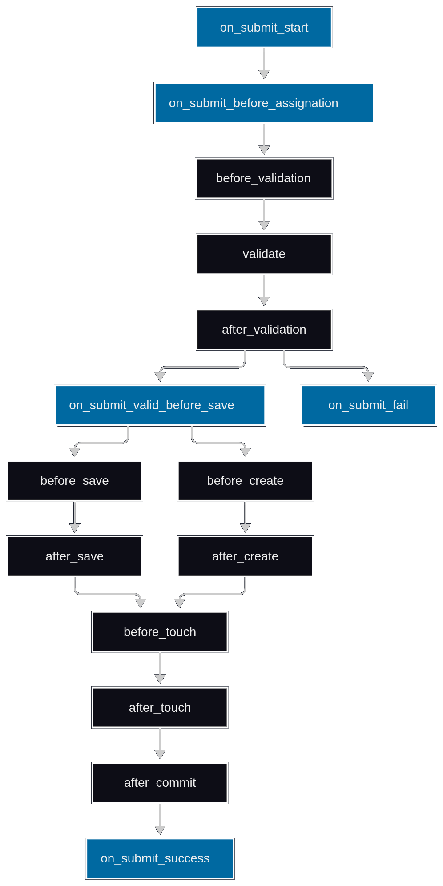

# Cycle de vie

*Submit64* permet d'intervenir à différentes étapes du cycle de vie d'un formulaire grâce à des événements configurables dans le modèle `ActiveRecord`.

Ces événements permettent notamment d'exécuter des traitements personnalisés avant ou après certaines opérations, par exemple lors de la soumission d'un formulaire.  Ils peuvent être utilisés pour compléter le comportement standard de *Submit64* avec la logique propre à votre application.

Le schéma ci-dessous présente les différentes étapes du cycle de vie d'un enregistrement `ActiveRecord` (en noir) et les événements *Submit64* (en bleu).  

{width=500px}


## Définir des événements

Les événements sont définis dans la méthode `submit64_lifecycle_events`, qui retourne un hash associant chaque événement à une fonction à exécuter.  
Par exemple, pour exécuter un traitement après la réussite d'une soumission :

```ruby [article.rb]
class Article < ApplicationRecord
  extend Submit64::MetadataProvider

  def self.submit64_lifecycle_events
    {
      on_submit_success: -> () { puts "well done!" }
    }
  end

end
```

Dans cet exemple, le bloc associé à `on_submit_success` est exécuté lorsque la soumission du formulaire a réussi.

## Arguments d'événements

Tous les événements transmettent des arguments à la fonction appelée.  
Ceux-ci permettent d'accéder aux données liées à l'opération en cours et d'adapter le traitement en conséquence.

Par exemple, pour accéder à l'instance de la ressource lors de l'étape précédant son enregistrement, après validation des données :

```ruby [article.rb]
class Article < ApplicationRecord
  extend Submit64::MetadataProvider

  def self.submit64_lifecycle_events
    {
      on_submit_valid_before_save: -> (on_submit_data, context) { puts on_submit_data.resource_instance.id }
    }
  end

end
```

Dans cet exemple, la fonction reçoit deux arguments :

- `on_submit_data` : contient les données liées à la soumission, notamment l'instance de la ressource via `resource_instance`
- `context` : le [contexte](./080_context.md)

Le traitement peut ainsi exploiter les informations disponibles à cette étape du cycle de vie pour effectuer des opérations complémentaires.

## `submit64_lifecycle_events`

<!--@include: ./999_definition.md#submit64-lifecycle-events-->